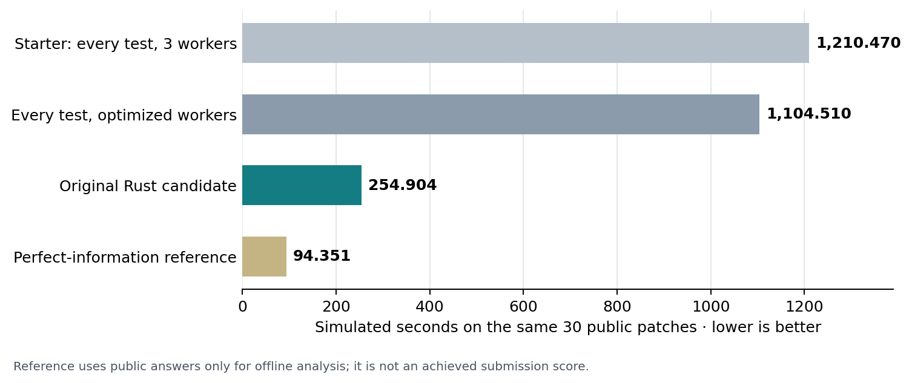

# Executive result

An original Rust submission candidate has been built, compiled, and tested against the organizer's public sample. It scores **254.904 simulated seconds with zero missed commits**. Three native runs produced byte-identical output; the median total including local process CPU was **255.718330 seconds**. This is a **78.94% reduction** from the starter on the same 30 patches.

The research identified a directly attributable top-five repository in the 05:28:35 UTC leaderboard snapshot: **team 67's [jason-scheffel/nap-time](https://github.com/jason-scheffel/nap-time/blob/4f7b17a17c962f04bbe49e1a1b85b05b972243ae/README.md)**. Six public implementations were examined at fixed commits. Four leader-to-repository identities from that snapshot remain unverified. Local sample scores were not used to guess leaderboard identities.

**Release status:** source and local sample validation complete; container build/run and official submission not performed. Docker was unavailable here. Rust 1.85.1, the compiler used by the Dockerfile, was separately installed and successfully compiled and tested the standalone source. The exact container check is supplied in the package.

## Deliverables

| Deliverable | Intended use |
| --- | --- |
| Report in PDF, DOCX, and Markdown | Rules, search evidence, six repository decodes, scoring mathematics, implementation decisions, limitations |
| Blast_Radius_Rust_Submission.zip | Repository folder with root Dockerfile, Rust source, baseline map, syntax front end, profiling tools, tests, validation receipts |
| submission.rs | Original standalone Rust source; the complete package supplies the runtime map and syntax front end |
| docs/validation.json, inside ZIP | Three native runs, output/scorer hashes, timings, validity |
| docs/scale-validation.json, inside ZIP | Duplicate 45-patch workload check; not new correctness evidence |

The panel had complementary research, scoring/failure-review, and Rust implementation roles. The coordinating implementation generated its own baseline maps and integrated the reviewed design. Competitor source and generated maps were not incorporated.

# Submission contract

The task is test selection plus scheduling for independent patches against SQLGlot commit `eb11aec4be8cb2122afe713a4816662c3f0fb2fa`. A valid selection includes **every failing numbered test**, not merely one test that detects the bug. [Official track](https://www.joinbuilders.org/buildathon/tracks/blast-radius); [exact scoring specification](https://www.joinbuilders.org/buildathon/tracks/blast-radius/files/SCORING.md?inline=1).

| Item | Observed requirement |
| --- | --- |
| Cutoff | 22 November 2026, 11:00 AM EST / 16:00 UTC |
| Reward | $5,000 for the track winner; practice standings do not determine the prize |
| Hand-in | Public GitHub repository, root Dockerfile, optionally a full 40-character commit |
| Source budget | 20,000,000 bytes; submodules and LFS are not fetched |
| Build | Networked; 4 cores, 8 GB, 10 minutes |
| Run | Offline; 2 cores, 4 GB, 180 seconds; final allowance 270 seconds |
| Filesystem | Read-only root; UID/GID 65534; HOME=/tmp; 64 MB temporary area |
| Output | Strict JSONL; no repeated tests; at most eight nonempty workers; stderr logs |
| Quota | Four submissions/hour observed, matching the screenshot; live allowance can change |

Sources: [track](https://www.joinbuilders.org/buildathon/tracks/blast-radius), [status](https://www.joinbuilders.org/buildathon/status), [event guide](https://www.joinbuilders.org/buildathon). The screenshot warns that rejected attempts consume a slot; complete the container check before pressing Submit.

This rebuild uses independently authored logic and maps derived from the unmodified pinned program. Patch-to-failure lookups, edit-type answer tables, and competitor code/map reuse are excluded. Public algorithms were examined and independently rebuilt into a coherent design.

# Implementation and panel decisions

## Runtime flow

1. Apply each patch independently in memory against baseline source; validate hunk coordinates, original contents, and final-newline markers.
2. Use Python's AST parser and compiler to identify syntax failure, structural equality, and real code changes. Preserve docstrings and type comments.
3. Write a small temporary analysis file, then replace the front end with Rust.
4. Validate catalog/map identities. Unknown or unsupported inputs broaden the selection; syntax errors select all tests.
5. Union tests covering the enclosing function by default. Fixture changes retain readers; module/header changes retain importers and actual dialect/class consumers.
6. Keep source-reading and code-metadata-sensitive tests even for AST equality.
7. Evaluate one through eight workers in integer milliseconds, improve partitions with bounded exchanges, add free zero-duration/reserve tests, and emit deterministic JSONL.

The Rust program uses no external crates. Python performs language parsing; SQLGlot tests are not executed during evaluation. Baseline profiling happens while preparing the committed map.

## Baseline provenance

The coverage profile passed **1,620 tests and 25,440 subtests** on the unchanged pinned source. It captures lines, functions, scoped fixture setup, source/fixture reads, and process-pool work. The pool keeps original task functions and arguments while scheduling two processes.

A second baseline run passed all **1,620 tests**, observing actual dialect lookup/construction, cached registries, registry enumeration, uppercase attributes, and class/component inheritance across **109 modules**. Merging it added **12,218 module-to-test edges**. Static class-export aliases complement the dynamic facts, including direct nested tokenizer references.

Interning repeated sets reduced the raw map from approximately 21.9 MB to **11,443,109 bytes**. It stores baseline commit, ordered test identities, passing profile evidence, and generation provenance. Neither builder accepts patches or answer labels.

Map SHA-256: `fc0dd0d67f242f6afab39af2e11deb6bbd24f339e56e9e6b53553931aed5cdc4`.

## Findings that changed the design

| Finding | Consequence | Final treatment |
| --- | --- | --- |
| A short-circuit mutation escaped exact line coverage | Callers can be affected without executing the old changed line | Function coverage is the default; line mode is experimental |
| An inserted else can affect the opposite branch | Adjacent-line coverage can be incomplete | Semantic insertions widen to the function |
| Lazy imports hid dialect consumers | Initialization is not repeated per test | Dynamic usage profile plus static export aliases |
| Syntax errors can invalidate collection broadly | Incomplete import graphs are insufficient | Select all tests |
| Shared setup reads fixtures once | Later class tests can lose dependencies | Expand setup context across its scope |
| Comments can be data or metadata | Textual skipping is unsafe | AST checks for Python; retain fixture consumers |
| Source/code inspection observes otherwise equal code | Equality alone can miss failures | Retain source and metadata readers |

The independent release review found no missing required own-file, dynamic, or direct-import consumers in six repaired dialect families. That validates those specific repairs, not every possible hidden dependency.

# Final local evidence



All comparisons below use the same 30 sample patches. The website's 1,614.1-second baseline belongs to a different server batch and is not the comparison denominator.

| Measurement | Result |
| --- | ---: |
| Starter, three workers | 1,210.470 simulated seconds |
| Run-all, optimized workers | 1,104.510 simulated seconds |
| Final candidate | **254.904 simulated seconds** |
| Missed commits in each of three runs | **0** |
| Median local CPU-inclusive total | 255.718330 seconds |
| Local tenth-second rounded value | 255.7 seconds |
| Entrypoint CPU across measured runs | 0.623–0.954 seconds |
| Output | 34,062 bytes; identical hashes across runs |
| Regression cases | 52 passed: 29 Rust, 23 Python |
| Duplicate scale check | 45 patches; valid, zero misses; 54,450 bytes |

The expanded batch duplicates existing patches under new IDs. It checks workload growth, not semantic generalization.

An earlier line-policy experiment cost 241.019 seconds before penalties but missed one commit, producing 541.019 penalized seconds. Function coverage removed the miss. Repairing lazy-import maps raised selection cost from 248.066 to 254.904 seconds because real consumers were added. The final artifact uses the repaired map.

## Limits

- Docker has not been built or run here. Native compiler compatibility does not establish container execution success.
- No official submission or hidden score exists for this candidate.
- Baseline profiles used Linux x86_64 and Python 3.13.5; the runtime uses the organizer's exact image digest. Version provenance is recorded.
- Whole-suite traces can hide cold-cache behavior. Native file reads, teardown, reflection, and environmental dependencies are not comprehensively proved complete.
- Some module/class edits intentionally over-select. Warm-fork verification, staged executor replay, and sampled heavy-test pruning are not in this candidate.

# Highest-value next optimizations

The measured opportunity is dependency precision and validated verification. The complete native entrypoint already uses less than a second of local CPU, while individual conservative selections cost tens of simulated seconds.

**Import-time attributes.** Two sample selections each cost 36.817 seconds because import dependencies retain almost the entire suite. Attribute-reader facts plus a validated import-state check could narrow those decisions. This is a hypothesis to test, not a promise about hidden scores.

**Expensive stage boundaries.** Several selections retain the 21.454-second executor test. Before removing it, prove that affected stages hand unchanged inputs to unchanged downstream code, or execute all necessary work within a justified CPU budget. Passing a sample of that work is weaker evidence.

**Fresh-process traces and independent mutations.** Union cold-process profiles with suite profiles. Label independent changes using the full suite, including insertions, defaults, class constants, fixtures, syntax failures, and mixed patches. Keep those labels outside runtime.

**Cost-bounded full-test verification.** Spend CPU only when the expected reduction in scheduled time exceeds execution, import, and setup cost. Preserve candidates after partial, interrupted, or inconclusive checks. Warm forks can reduce cost, but state isolation needs validation.

Already implemented opportunities include worker-count choice, zero-duration coverage, and filling worker slack. Their score/recall benefits do not require a new semantic shortcut.

# Container check and hand-in

Unpack the source archive, enter its repository directory, and run:

```bash
make fetch-kit
make test
make check-package
make sample
```

The last command is the remaining Docker gate. It uses Linux amd64, no runtime network, two CPUs, 4 GB memory, UID/GID 65534, read-only files, 64 MB temporary storage, and the official scorer. The sample kit is hash-checked and excluded from the image.

After it succeeds, push the files to your own public GitHub repository with Dockerfile at the root. Submit that URL and the full reviewed commit. Recheck live cutoff and allowance. No submission slot was consumed by this work.

Standalone Rust SHA-256: `d6f02a6c5615135e917d35bf77f08535f1bed221f79f86121b412dacb6eeee92`. Use the complete package for the baseline map and syntax front end; the Rust file alone also compiles and provides an all-tests fallback when the map is unavailable.

\newpage

# Repository investigation and six implementation decodes

The following review separates identities, self-reported scores, inspected source, and unverified attribution. Full hashes remain in source links and packaged provenance; table hashes are abbreviated for readability.


Research date: **22 November 2026**. Source inspection is of the exact commits below, obtained publicly with `git clone`. This is an architecture review, not a reproduction of their scores. No competitor code or generated map has been copied into the independent submission.

## What the leaderboard actually establishes

Official track: https://www.joinbuilders.org/buildathon/tracks/blast-radius  
Official leaderboard: https://www.joinbuilders.org/buildathon/leaderboard

The latest official refresh, retrieved **22 November 2026 at 05:28:35 UTC**, had these **practice** standings. The order comes from the structured `rank` field embedded in the official page, not the page's alphabetical rendering:

| Rank | Team | Score, seconds | Timestamp of this scored entry, UTC | Public repository / submitted commit |
|---|---|---:|---|---|
| 1 | RoboM | 100.9 | 2026-11-22 04:44:29 | Not disclosed in the public standings |
| 2 | ImagineLosing | 102.5 | 2026-11-22 03:42:32 | Not disclosed in the public standings |
| 3 | Flare | 103.0 | 2026-11-22 05:20:59 | Not disclosed in the public standings |
| 4 | 67 | 103.3 | 2026-11-22 02:26:29 | [jason-scheffel/nap-time](https://github.com/jason-scheffel/nap-time), explicitly identified by its author; scored commit unknown |
| 5 | Aqua | 103.3 | 2026-11-22 05:11:53 | Not disclosed in the public standings |

The board moved during research: at the earlier 05:15:53 UTC snapshot Flare had 103.1 s, Slightly Desaturated Orange was fifth at 104.2 s, and `@GMUNVIS` was sixth at 106.0 s. Aqua subsequently entered fifth at 103.3 s. Team 67 ranks ahead of Aqua at the same displayed score under the earlier-submission tie rule. These standings can change again. The public page gives team, rank, score and timestamp; it does **not** give repository URL or submitted SHA. The official final is a separate unseen set.

### Repository identification effort and evidence boundary

Public GitHub repository search for recent Blast Radius projects initially returned 338 results. Across result pages and the complementary Buildathon query, the investigation collected 336 unique accessible metadata entries and read 297 public READMEs. This first pass did not identify a leader. The optimized second pass searched exact team names across file contents, followed cross-track public attribution, and searched the pinned SQLGlot source fingerprint to find entries with unrelated repository names.

**The second pass identified team 67's public entry: [jason-scheffel/nap-time](https://github.com/jason-scheffel/nap-time).** Its [README at the inspected commit](https://github.com/jason-scheffel/nap-time/blob/4f7b17a17c962f04bbe49e1a1b85b05b972243ae/README.md) begins “nap-time: Blast Radius entry of team 67.” This establishes an explicit author-declared team/repository connection. It does not establish that the inspected HEAD is the commit scored at 103.3 s. No public submitted SHA was found.

The other four current top-five repository identities—RoboM, ImagineLosing, Flare, and Aqua—remain unverified. The earlier fifth-place team, Slightly Desaturated Orange, also remains unidentified. Exact-score hits for 100.9 and 102.5 turned out to be sample estimates or extrapolations in other projects; those were rejected as identity evidence. The detailed search log and rejected leads are in `search_method.md`.

The report therefore contains **one author-identified top-five entry and five additional public submissions relevant to the track**. It does **not** claim that all six are top-five entries. All inspected commit hashes pin the source reviewed, not the organizers' scored commits. The five earlier candidate reviews are retained because their logic is useful and was directly inspected.

## Public implementations inspected

| Repository | Inspected commit | Main approach | Published performance evidence |
|---|---|---|---|
| [jason-scheffel/nap-time — team 67](https://github.com/jason-scheffel/nap-time) | `4f7b17a17c96` | Baseline semantic observations, cache-aware dependencies, reduced tests in warm forks, import-state validation, baseline execution caches | Explicit author team identity; team 67 is fourth at 103.3 s in the official snapshot; scored SHA unknown |
| [Masudali23/blast-radius](https://github.com/Masudali23/blast-radius) | `716ebd1f591f` | Coverage plus AST changes, warm forked execution, fine-grained fixture and value observations | No leaderboard identity established; source reviewed, benchmark not rerun |
| [ks129/blast-radius](https://github.com/ks129/blast-radius) | `aa2c233ebb8d` | Rust coordinator, generated dependency maps, Python fork servers, heavy-test adapters | No official score linked; source reviewed, benchmark not rerun |
| [Figo-Koala/blast-radius](https://github.com/Figo-Koala/blast-radius) | `fab888449afa` | Baseline observations, expression reasoning, guarded dynamic verification, improved scheduling | README claims 99.830 simulated / 102.3 total local sample seconds, zero misses |
| [EvanDamron/blast-radius-selector](https://github.com/EvanDamron/blast-radius-selector) | `3539bb63caf4` | Layered static narrowing, comparison/dict/default observations, stage fingerprints for expensive tests | README claims 101.4 simulated sample seconds, zero sample misses; 399 labeled synthetic mutations with zero misses |
| [ByteForge1729/blast-radius](https://github.com/ByteForge1729/blast-radius) | `fb71c0ed6729` | Coverage, import-state fingerprints, class readers, cost-gated reruns, selected query probes | README records sample 107.5 simulated and older practice 179.9 total; neither establishes current rank |

Self-reported local results in this table are not independently verified, not scores on a common newly run benchmark, and not comparable directly with the official hidden practice board. The source trees were read but not executed.

## 2A. Decode: team 67 — jason-scheffel/nap-time

Primary sources at the inspected commit: [README](https://github.com/jason-scheffel/nap-time/blob/4f7b17a17c962f04bbe49e1a1b85b05b972243ae/README.md), [selector](https://github.com/jason-scheffel/nap-time/blob/4f7b17a17c962f04bbe49e1a1b85b05b972243ae/app/selector.py), [patch/execution engine](https://github.com/jason-scheffel/nap-time/blob/4f7b17a17c962f04bbe49e1a1b85b05b972243ae/app/engine.py), [operand analysis](https://github.com/jason-scheffel/nap-time/blob/4f7b17a17c962f04bbe49e1a1b85b05b972243ae/app/infect.py), [DuckDB replay](https://github.com/jason-scheffel/nap-time/blob/4f7b17a17c962f04bbe49e1a1b85b05b972243ae/app/duckreplay.py), [Dockerfile](https://github.com/jason-scheffel/nap-time/blob/4f7b17a17c962f04bbe49e1a1b85b05b972243ae/Dockerfile).

### Core idea and dependency planning

The entry uses baseline knowledge to find the tests that can observe a patch, then evaluates those tests cheaply enough to retain mainly actual failures. Its optimization effort reaches below test selection into Python imports, individual fixture cases, loop iterations, database calls, and interpreter startup.

Each patch is applied in memory. Function-body edits use executed-line dependencies, module/class initialization edits use definition-time dependencies, and fixture edits use file readers. Bytecode equality can eliminate ordinary comments, with separate handling for source-reading and documentation-sensitive tests. Changes that cannot be understood safely widen selection.

The operand-analysis layer records relations between values, boolean outcomes, and relevant primitive value classes on the unchanged pinned checkout. For a supported single operator or literal edit, it computes whether the new operation would change an observed result. This differs from merely asking whether a test executed the edited line: a covered comparison may still produce the same truth value after an edit. The implementation includes a particularly consequential correction for caches: a full-suite trace may record an operation only in the first test that populates a cache. Its isolated-test reachability artifact restores later tests that consume the cached result. These semantics are implemented in [infect.py](https://github.com/jason-scheffel/nap-time/blob/4f7b17a17c962f04bbe49e1a1b85b05b972243ae/app/infect.py).

### Runtime isolation and reduced execution

A warm parent imports the baseline SQLGlot code and test modules once, then forks children. Ordinary function edits can replace code objects without repeating imports. A changed closure layout causes fresh imports because the old closure cells would otherwise carry incorrect bindings. Initialization edits compare patched import state with baseline fingerprints. Some changes qualify for importing only the affected module and its importer cone, but runtime validation can fall back to a full import. The [engine](https://github.com/jason-scheffel/nap-time/blob/4f7b17a17c962f04bbe49e1a1b85b05b972243ae/app/engine.py) and [cone module](https://github.com/jason-scheffel/nap-time/blob/4f7b17a17c962f04bbe49e1a1b85b05b972243ae/app/cone.py) implement these paths.

Tests can be reduced to statements, fixture entries, pool tasks, or loop passes whose baseline execution reaches changed code. Recompilation and fidelity checks restrict reductions to supported test shapes. Selected fixture-only patches may share a child, provided state restoration checks pass; a failed check returns later patches to separate children. This is a substantial engineering distinction: reducing work is useful only if the reduced run preserves the observation that would make the original test fail. Relevant modules are [reduce.py](https://github.com/jason-scheffel/nap-time/blob/4f7b17a17c962f04bbe49e1a1b85b05b972243ae/app/reduce.py), [iterred.py](https://github.com/jason-scheffel/nap-time/blob/4f7b17a17c962f04bbe49e1a1b85b05b972243ae/app/iterred.py), and the selector.

CPU guards stop expensive verification. A stopped test receives an unresolved cost status and stays selected. Hung pool tasks also cause dependent later tests to be retained. This preserves a fallback when the verifier cannot finish. The selector ultimately packs retained tests across up to eight workers.

### Baseline caching and runtime cost

The database replay layer associates a connection's initial arguments and ordered modifying SQL statements with a database state. For a recorded SELECT on a recorded state, it can return the baseline answer. An unfamiliar SQL string, parameter, or connection method falls back to a real DuckDB connection, rebuilding the state first. A build-time rehearsal checks that enabling replay preserves baseline test verdicts. These details are visible in [duckreplay.py](https://github.com/jason-scheffel/nap-time/blob/4f7b17a17c962f04bbe49e1a1b85b05b972243ae/app/duckreplay.py) and [its builder](https://github.com/jason-scheffel/nap-time/blob/4f7b17a17c962f04bbe49e1a1b85b05b972243ae/app/build_duck_replay.py).

Executor input tables are packed separately and loaded lazily; numpy, pandas, and DuckDB are also deferred. Saved baseline import fingerprints and uncompressed maps reduce parent preparation. The Docker build attempts a faster build of the same CPython version, checks its digest and relevant behavior, retains the pinned SQLite extension, and falls back to the original interpreter if validation fails. These mechanisms target selector CPU, which contributes directly to the contest objective. See [preload.py](https://github.com/jason-scheffel/nap-time/blob/4f7b17a17c962f04bbe49e1a1b85b05b972243ae/app/preload.py), [lazymods.py](https://github.com/jason-scheffel/nap-time/blob/4f7b17a17c962f04bbe49e1a1b85b05b972243ae/app/lazymods.py), and the Dockerfile.

### What this supports, and what remains uncertain

The source explains a credible route to low scores: detailed dependency observations reduce candidates; guarded execution removes passing candidates; specialized baseline caches make that execution inexpensive. The README declares that its shipped maps come only from the pinned program and unchanged test suite. This review did not regenerate the maps, reproduce the reported score, inspect the organizers' scored commit, or establish organizer approval of every shortcut. Whole-suite caches, global state, descriptor behavior, import side effects, test reductions, and database replay all require careful semantic validation.

**Independent design lessons:** distinguish initialization from call-time edits; correct for cache-hidden dependencies; use guarded verification; validate reduced execution; measure both selected-worker cost and selector CPU. These are architectural observations, not copied code or permission to reuse another team's generated artifacts.

## Decode: Masudali23/blast-radius

Primary files: [selector.py](https://github.com/Masudali23/blast-radius/blob/716ebd1f591ffe8b8108607109eba7a4af4b8f61/selector.py), [br/plan.py](https://github.com/Masudali23/blast-radius/blob/716ebd1f591ffe8b8108607109eba7a4af4b8f61/br/plan.py), [br/engine.py](https://github.com/Masudali23/blast-radius/blob/716ebd1f591ffe8b8108607109eba7a4af4b8f61/br/engine.py), [README](https://github.com/Masudali23/blast-radius/blob/716ebd1f591ffe8b8108607109eba7a4af4b8f61/README.md).

### Logic

The design first estimates the complete set of tests that could observe a patch, then spends limited CPU to remove candidates that pass on the patched program. It is therefore a combination of dependency analysis and selective re-execution.

The baseline artifacts separate lines executed during normal function calls from statements executed while modules and classes are initialized. They also record file access, class use, dictionary entry reads and fixture-entry coverage. A unified diff is applied to the original pinned checkout. Structural comparison identifies the changed statements and whether each change occurs at call time or import time. Tests linked to those statements become candidates.

Runtime work uses progressively warmed Python processes: one has only third-party libraries, another has the SQLGlot core, and a third has dialects, tests and fixtures. The chosen parent is the warmest process that has not already loaded state the patch invalidates. A forked child receives the changed source through an overlay; function-only changes can use replacement code objects, while initialization changes require fresh imports. Passing candidates can disappear from the emitted worker schedule. Errors, incomplete checks and unverified candidates generally remain selected.

The cost controller computes how much a candidate would add to the *best worker schedule*, rather than treating its full recorded duration as the benefit of removing it. Cheap tests run first. Before any failure has been found, eliminating the whole candidate set can also eliminate a worker's two-second charge. After a failure, that fixed charge is already unavoidable, so the controller becomes less eager to run additional candidates. Recorded test cost is calibrated to expected evaluator CPU and compared with expected schedule savings.

### Why it can be effective

Warm forks reduce Python import and third-party library setup costs. Fixture-entry slicing avoids replaying every SQL query when a change reaches only a few. For the especially expensive executor test, staged fingerprints can recognize that the expensive later stage receives the same inputs and unchanged code. This targets the largest items on the critical worker path.

### Limits visible in source

The default policy is more aggressive than a blanket statement that all uncertainty is retained. `HEAVY_CLEAN` defaults to dropping certain unverified slow tests after cheaper tests and limited fixture probes pass. `HEAVY_FAILED` can use passing neighboring tests and a sample of the heavy test to drop it even when other tests fail. These are empirical risk decisions, not proofs that the entire heavy test passes. A final-set change that affects only an unsampled query can defeat that policy.

The repository also has precomputed alternative-comparison and boolean-observation machinery. Whether a particular generated artifact is an allowed baseline observation or a forbidden edit-class-to-answer table depends on precisely what is stored and how it was produced. This review does not certify organizer acceptance. Copying such artifacts would be inappropriate; the independent implementation should stay with plainly permitted baseline coverage/import/fixture maps.

**Transferable principle:** make rerun decisions using marginal schedule cost and preserve explicit uncertainty. **Avoid treating as a proven guarantee:** sampled heavy tests, scaled tests, or similarity to passing neighboring tests.

## Decode: ks129/blast-radius

Primary files: [selector/src/main.rs](https://github.com/ks129/blast-radius/blob/aa2c233ebb8da99cc504a6b7d2735b3142d45c54/selector/src/main.rs), [app/runner.py](https://github.com/ks129/blast-radius/blob/aa2c233ebb8da99cc504a6b7d2735b3142d45c54/app/runner.py), [Dockerfile](https://github.com/ks129/blast-radius/blob/aa2c233ebb8da99cc504a6b7d2735b3142d45c54/Dockerfile), [README](https://github.com/ks129/blast-radius/blob/aa2c233ebb8da99cc504a6b7d2735b3142d45c54/README.md).

### Logic

This is a useful architectural reference for a Rust entry, but its complete system is not Rust-only: Rust controls analysis, scheduling and job orchestration, while Python executes Python tests. The Rust crate uses the standard library and custom input parsing; the image builds it in a Rust stage and places the executable in the organizer-compatible Python runtime.

The map stores per-test source coverage, module imports, resource reads, directory listings and class use. Tests are matched by stable pytest node IDs to the current manifest's numeric IDs. An unfamiliar manifest test is conservatively retained when Python changes, avoiding reliance on fixed sample numbering.

The selector reads all patches, creates plans, and groups candidate tests into jobs. Two Python runner servers can execute independent jobs in forked children. A symlink farm under `/tmp` points unchanged paths to the immutable checkout and materializes only changed files. This keeps both copying and temporary disk use smaller than cloning SQLGlot per patch.

Tests are ordered cheaply first; some small jobs stop at the first failure because retaining remaining cheap candidates can cost less than spending more CPU. Changed modules receive compile/import probes. If a module cannot be imported, the dependency map expands the retained set to its importers. Runner crashes, incomplete outcomes and timeout-limited jobs retain candidates. Work stops at a wall-time budget, after which unresolved selections are still emitted.

Heavy-test adapters subdivide executor fixtures and dialect-memory subtests. The final numeric test remains the scheduling unit, but an adapter may internally evaluate only the affected subitems. Worker placement uses descending-duration greedy packing for each worker count from one to eight, then picks the least expensive result.

### Strength and limits

The Rust coordinator makes patch parsing, map lookup, set operations and output cheap; Python remains only where required by the tested language. Stable node IDs, read-only source overlays, deadline fallback and parent/child isolation address practical evaluation constraints.

A custom Python line classifier cannot claim the full semantic precision of Python's parser. Scaled-down tests and subitem adapters must establish that omitted work cannot detect the patch; making a test faster can also make it fail to observe the original defect. Baseline trace completeness remains critical. This repository's existence does not establish that converting a Python selector to Rust alone produces a winning score; most potential gains come from selecting fewer tests without missing failures.

**Transferable principle:** use Rust for deterministic orchestration and model Python execution as an optional, budgeted verifier with conservative failure handling.

## Decode: Figo-Koala/blast-radius

Primary files: [selector.py](https://github.com/Figo-Koala/blast-radius/blob/fab888449afa691f46162b3d9aaf8c2f400df133/selector.py), [schedule.py](https://github.com/Figo-Koala/blast-radius/blob/fab888449afa691f46162b3d9aaf8c2f400df133/schedule.py), [verify.py](https://github.com/Figo-Koala/blast-radius/blob/fab888449afa691f46162b3d9aaf8c2f400df133/verify.py), [README](https://github.com/Figo-Koala/blast-radius/blob/fab888449afa691f46162b3d9aaf8c2f400df133/README.md).

### Logic

The main abstraction is a selection with both strong candidates and reserve candidates, together with whether collection/import behavior is risky. A catalog maps the current test manifest into compact bitsets. Baseline artifacts include line/function coverage, resource access, resolved imports, receiver class information and observed scalar or parser-state values.

After patch application and structural comparison, ordinary dependencies provide a broad candidate set. Additional analysis attempts to prove that certain observed operations have the same outcomes under the changed expression. It restricts this reasoning to supported primitive values and supported edit shapes, with fallback when observations or receiver semantics are unknown.

Verification has three modes: static, collection-only, and adaptive. Collection checks detect files that cannot import. Adaptive checks can run candidate tests where the expected removed schedule cost exceeds import/setup and test CPU. Work is prioritized across a batch and dispatched through two threads with a shared deadline. If collection fails partway through, unchecked test files remain selected. Failed tests, subtests and errored collections are retained.

### Scheduling contribution

For each worker count, the scheduler starts with longest-processing-time packing. It uses a lower bound from the largest test and average load to skip unpromising worker counts. For two workers, an integer subset-sum calculation can improve a greedy split. After choosing a schedule, uncertain reserve tests may fill idle capacity without increasing either the number of workers or the busiest worker's duration.

That last property is a legitimate opportunity in this scoring model. If one worker has load 10 s and another 7 s, adding an uncertain 2 s test to the second worker leaves the maximum at 10 s. The simulated cost does not increase. The actual CPU of computing this addition is still chargeable, but a small packing pass is inexpensive. Such extra coverage can reduce miss risk for nearly no simulated cost.

### Limits

The supplied README explicitly distinguishes arm64 local checks from amd64 evaluation and acknowledges one memory-sensitive test did not pass under tracing. It retains that test through coverage and excludes it from pass-based pruning. This is useful honest uncertainty handling. Sample and small synthetic-set success still do not prove unseen behavior. Observational expression proofs need complete relevant traces and consistent handling of side effects, short-circuit evaluation and custom comparison methods.

**Transferable principle:** keep reserve dependencies and use free worker headroom to improve recall; treat collection completion as evidence that must be tracked per file.

## Decode: EvanDamron/blast-radius-selector

Primary files: [selector.py](https://github.com/EvanDamron/blast-radius-selector/blob/3539bb63caf4b0edbb07136038f6b60e226171c1/selector.py), [base_selector.py](https://github.com/EvanDamron/blast-radius-selector/blob/3539bb63caf4b0edbb07136038f6b60e226171c1/base_selector.py), [more.py](https://github.com/EvanDamron/blast-radius-selector/blob/3539bb63caf4b0edbb07136038f6b60e226171c1/more.py), [README](https://github.com/EvanDamron/blast-radius-selector/blob/3539bb63caf4b0edbb07136038f6b60e226171c1/README.md).

### Logic

This entry is organized as a conservative selector followed by several narrowing passes. Each narrowing pass should reduce the initial candidate set only when a narrowly defined edit can be shown not to affect a test's observed behavior. The main routine saves and restores the prior selection if some refinement raises an exception.

Baseline coverage is collected with isolated test processes and child-process tracing. Additional indexes record class attributes, dictionary accesses, default arguments, argument validation, fixture parts and comparisons. Runtime AST comparison recognizes a supported local change and chooses a matching refinement. For example, an edit to a single dictionary key can retain tests that read that key or read the dictionary as a whole; changing a function default keeps tests whose calls may have consumed that default.

The expensive executor test receives several staged checks: affected query entries are found from coverage, then hashes of stage outputs are compared against baseline. If changed code operates only in an early stage and the output passed to an unchanged later stage is identical, the costly later stage can be skipped. More complete stages include execution plans and generated Python code. A separate memory-test probe reruns affected dialects.

The final optional execution stage only accepts small, executable candidate sets with estimated CPU below a fraction of their schedule cost. The emitted schedule then uses longest-first packing over one to eight workers. It exits after flushing output, avoiding unnecessary interpreter object teardown.

### Limits and rule questions

The README describes precomputing which alternative comparison operators differ on baseline operands, and fixture instrumentation that poisons selected fixture parts. These are more specialized than ordinary line coverage. The TYPE_CHECKING discussion also reports labels from flipping every such block. Testing mutations locally is different from using mutation outcome tables in the final executable, but the distinction must be auditable. This review does not infer a rule violation; it flags that such artifacts need a clear provenance audit before reuse of their *ideas*.

Statements that annotations or comments cannot matter must account for doctests, introspection and source-reading tests. The implementation includes source-reader retention, but any incomplete reader map can invalidate the claim. Fingerprint equivalence also requires the supposedly unchanged downstream stage to have no relevant hidden state or environmental variation.

**Transferable principle:** make refinements narrowly applicable, preserve the pre-refinement candidate set on errors, and reason about what crosses a stage boundary rather than rerunning expensive unchanged work.

## Decode: ByteForge1729/blast-radius

Primary files: [selector.py](https://github.com/ByteForge1729/blast-radius/blob/fb71c0ed672992bddec555626f722cfab8d6d48a/selector.py), [br/impact.py](https://github.com/ByteForge1729/blast-radius/blob/fb71c0ed672992bddec555626f722cfab8d6d48a/br/impact.py), [br/importcheck.py](https://github.com/ByteForge1729/blast-radius/blob/fb71c0ed672992bddec555626f722cfab8d6d48a/br/importcheck.py), [README](https://github.com/ByteForge1729/blast-radius/blob/fb71c0ed672992bddec555626f722cfab8d6d48a/README.md).

### Logic

The implementation separates analysis, import checks, expensive-query probes, cheap test verification and scheduling. Baseline coverage is supplemented by fixture and class-use maps. Every patch is analyzed independently; unknown paths and internal errors fall back to all tests.

For changes to module or class initialization, it compares the state produced by importing the patched program with the baseline state. If only a class or module attribute changes, reader indexes can identify tests that consume that attribute. Constructors forwarding constants into instance fields are also considered. An import crash leads to broad selection rather than assuming the local changed statement's coverage is sufficient.

Import-state comparison itself has a CPU price, so it is skipped when the current selection is already cheap. An expensive executor test can be pruned after affected query probes pass, subject to a maximum query count and restrictions on import-time changes. A small remaining test set can be run in a fresh import environment, retaining only failures if the run finishes cleanly.

The source's current verifier limit is **3 recorded seconds**, while the prose README still describes two seconds. That small discrepancy illustrates why source inspection matters. The source also accounts for executor/optimizer class setup cost and declines verification when estimated CPU is more than a fixed share of the simulated selection cost.

### Limits

The published results show why sample scores and hidden scores must be kept apart: the README gives a roughly 107.5 simulated sample result but a 179.9 total hidden practice result for an earlier cited version. It also describes 104 synthetic mutations where the selector has much more excess cost than the oracle. Neither figure justifies identifying it with a current top-five team.

An equivalence shortcut treats identity and equality comparisons involving `None` and certain enums as interchangeable outside an excluded executor file. That depends on the program's actual operand types and custom equality methods; it is not a general Python equivalence. The README acknowledges differences from running worker pools inline, architecture-specific trace paths and state reachable outside module globals.

**Transferable principle:** spend verification CPU only where it can save more score, and inspect import-time state separately from function-body coverage.

## Panel synthesis for an independent Rust entry

The broadly shared design is a hierarchy:

1. **Baseline facts:** gather coverage, imports and file/fixture access from the allowed pinned checkout, recording provenance and test node IDs.
2. **Patch localization:** identify changed old lines, inserted boundaries, changed files and structural uncertainty. Runtime code and initialization code need different treatment.
3. **Conservative candidate union:** include every test linked by the relevant evidence; widen for syntax/import failures, test/config changes and unmapped input.
4. **Optional evidence gathering:** run cheap checks only when their expected simulated saving exceeds CPU cost. A partial or failed check must not become a passing result.
5. **Schedule optimization:** enumerate worker counts, improve packing where cheap, and add uncertain tests into existing idle capacity.
6. **Valid output under failure:** one line per commit, bounded output, manifest-valid IDs, no duplicates, conservative fallback before the run deadline.

The panel's principal disagreements concern how aggressively to remove expensive tests and how much semantic reasoning to trust. A new entry should make those choices explicit instead of silently adopting every public optimization. In particular, sampling a heavy test and observing no failure is evidence with a residual miss probability; it is not equivalent to executing the complete test.

The test-selection objective makes a false negative expensive: one missed failing test adds 300 seconds for that commit. The expected cost of dropping a group must therefore include the probability that **any** omitted failing test exists. Removing a 1-second selection with a 1% miss chance costs about 3 seconds in expected penalties before any worker overhead is considered. Conversely, retaining an uncertain test inside existing worker headroom can have zero extra simulated duration. These are mathematical implications of the rules, not hidden-answer extraction.

## Rules relevant to decoding and rebuilding

The global leaderboard announcement says excessive code reuse, including another team's entry, may lead to disqualification at organizers' discretion; ordinary open-source libraries remain permitted. The track forbids sharing code between teams, using another team's repository/commit/archive, and tables from patches or kinds of edits to failing tests. It explicitly permits coverage, import and fixture maps built from the pinned commit. Sources: the official track and the 21 November 18:23 ET announcement on the official leaderboard.

Studying the public algorithmic design and independently implementing general concepts is distinguishable from copying the implementation or its maps. Keep the new source independently authored, generate its own artifacts from the pinned program, and keep patch-answer labels outside the submission runtime. Any advanced observation table should document exactly what was observed on unmodified baseline executions and why it is not a stored answer to an edit.

The inspection supports a detailed six-repository architecture comparison, including one entry explicitly identified by its author as belonging to a top-five team. It does **not** establish the other four leaders' repositories, any organizer-scored commit hash, independent reproduction of published benchmarks, compliance of every optimization, or a guaranteed winning hidden score.

\newpage

# Scoring mathematics and starter-file analysis

This independent analysis used organizer files and pinned baseline source, without competitor implementations. Its proposed extensions are distinct from the final implemented features and measurements above.


**Research checkpoint:** 22 November 2026, approximately 00:16 EST / 05:16 UTC.  
**Panel remit:** review the organizer's specification, downloaded starter, scoring code, and pinned SQLGlot baseline; propose an original strategy without examining competitors' code. Implementation status and measured results must be reported separately from these design recommendations.

## What the scoring objective actually rewards

The task is test selection and scheduling for independent patches against SQLGlot commit `eb11aec4be8cb2122afe713a4816662c3f0fb2fa`. It is essential to include **every** failing numbered test, rather than merely a small set capable of detecting that something is broken. The downloaded starter's scorer establishes this through an `any` check over the omitted failing IDs. A failure, error, timeout, or unimportable test file can contribute failures; a failed subtest fails its parent test. [S1, S2, S3]

For commit \(c\), let \(W_c\) be its nonempty workers, \(S_c\) their union, \(F_c\) the organizer's failing-test set, and \(d_i\) the recorded duration of test \(i\), in integer milliseconds. The objective is:

\[
C_c=\begin{cases}
0,& |W_c|=0,\\
\max_{w\in W_c}\sum_{i\in w}d_i+2000|W_c|,& |W_c|>0,
\end{cases}
\]

\[
T=\frac{\sum_c C_c+300000\sum_c\mathbf{1}[F_c\not\subseteq S_c]}{1000}+\text{container CPU seconds}.
\]

The cost is simulated from the supplied recorded durations. It is not reduced by making the selected tests run faster on one's own machine. Selector computation and any runtime probes are additional costs; build-time baseline analysis is not charged in this runtime objective. [S2]

This has several consequences derived from the objective:

- Reducing false negatives matters much more than shaving a few milliseconds from parsing.
- Every unnecessary selected test can add load, but the effect depends on worker balance.
- Every nonempty worker adds two seconds, so maximum parallelism is often worse.
- Keeping a selection empty on a truly harmless patch saves the startup cost as well as test time.
- The number of missed tests inside a commit does not multiply its 300-second penalty; one omitted failure is enough to trigger the full penalty.
- Tests with zero recorded milliseconds can be added to an already nonempty worker without increasing simulated time. This remains subject to output and CPU cost. Never create an extra worker solely to house such tests.

### Expected-risk threshold

If a more aggressive choice saves \(\Delta C\) seconds but raises the probability of missing at least one failing test by \(\Delta p\), its expected-score improvement is positive only when:

\[
\Delta C>300\Delta p.
\]

Saving two seconds permits less than a 0.667 percentage-point increase in miss probability. Saving 0.1 seconds permits less than 0.0334 percentage points. These are decision thresholds derived from the scoring formula, **not** calibrated probability estimates for a proposed model. Hidden final changes invalidate confidence derived only from repeated practice-board feedback.

## Starter files inspected and measured

The official archive was downloaded directly and safely extracted into `research/starter`. Its SHA-256 is:

`81efabbc69c3c4367d928f2dba0f33ce9dccccbd080b54721b2636e5d8afab9d`

It includes `Dockerfile`, `Makefile`, `README.md`, `SCORING.md`, `requirements.lock`, `score.py`, `selector.py`, `sample/tests.json`, `sample/answers.json`, and 30 independent sample patches. The archive was 38,398 bytes at retrieval. These are observations of the downloaded source, not claims about every future revision. [S3]

| Local measurement | Value |
| --- | ---: |
| Numbered tests | 1,620 |
| Test files represented | 58 |
| Recorded total duration of all tests | 103.047 seconds |
| Numbered tests with 0 ms recorded duration | 94 |
| Sample patches | 30 |
| Sample patches with no failing numbered tests | 12 |
| Code / fixture / mixed / comment sample kinds | 16 / 8 / 3 / 3 |
| Pinned Python dependency lines | 43 |
| Sample starter schedule: all tests, 3 workers | 1,210.470 simulated seconds |
| Sample best run-all schedule: all tests, 4 workers | 1,104.510 simulated seconds |
| Sample perfect-information optimum, excluding CPU | 94.351 simulated seconds |

The perfect-information result is an **offline evaluation reference** computed from the sample answers. It must never become a runtime patch lookup or a table from a kind of edit to failing tests. It is not a benchmark achieved by the submission, and it does not predict the practice or final score.

The baseline of 1,614.1 seconds displayed on the public track is not the same batch as the 30-patch sample. Compare a candidate with the local 1,210.470-second sample baseline when evaluating it locally, and compare server results only with results on the same server batch.

### Heavy tests change the scheduling optimum

| Number | Baseline test | Recorded seconds |
| --- | --- | ---: |
| 1490 | `tests/test_parser.py::TestParser::test_max_nodes` | 28.817 |
| 1106 | `tests/test_executor.py::TestExecutor::test_execute_tpcds` | 21.454 |
| 1224 | `tests/test_generator.py::TestGenerator::test_generator_memory` | 6.686 |
| 1107 | `tests/test_executor.py::TestExecutor::test_execute_tpch` | 3.863 |
| 1123 | `tests/test_executor.py::TestExecutor::test_optimized_tpch` | 3.537 |

Do not hard-code these sample numbers into the strategy: maps should identify test node IDs and resolve them against the current `/data/tests.json`.

For all tests, longest-processing-time-first scheduling gives these costs per commit:

| Nonempty workers | Cost in seconds |
| ---: | ---: |
| 1 | 105.047 |
| 2 | 55.524 |
| 3 | 40.349 |
| 4 | 36.817 |
| 5 | 38.817 |
| 6 | 40.817 |
| 7 | 42.817 |
| 8 | 44.817 |

For any fixed selected set, total work \(D\), largest task \(d_{max}\), and worker count \(k\), a useful lower bound is:

\[
\max(d_{max},\lceil D/k\rceil)+2000k.
\]

The four-worker all-test schedule attains the smallest of these lower bounds, so its 36.817-second cost is globally optimal for that selected set. The simple continuous approximation \(k\approx\sqrt{D/2000}\) overlooks large indivisible tests and would mislead here.

The 94.351-second sample oracle was also checked commit by commit: the best generated schedule equalled the minimum applicable lower bound for every nonempty failing-test set. This establishes the perfect-information optimum for the supplied sample, not the quality of a learned or static selector.

## Output and runtime details that can invalidate a good algorithm

The detailed scorer specifies one UTF-8 JSON object per patch filename, with exactly `commit` and `workers`. Its validation checks JSON, shape, known IDs, uniqueness, worker contents, and complete batch coverage. Duplicate test numbers across workers are rejected. Empty workers are discarded before counting costs and the limit of eight. Logs belong on stderr. [S2]

Implementation implications:

- Serialize through a correct JSON encoder, including escaped commit filenames.
- Enumerate patch files deterministically and emit every discovered commit once.
- Deduplicate the complete union before partitioning.
- Resolve numbers only from the current test catalogue; never emit skipped or unknown tests.
- Store durations in integers. The actual starter scorer uses `floor(seconds * 1000 + 0.5)`, i.e. half up for nonnegative durations.
- A final newline is normal; an additional blank line is invalid JSON.
- Keep output below the stated two-megabyte cap. The local `score.py` does not itself implement that surrounding harness limit, so a successful local score does not establish that limit was met.
- Validate the exact executable under the organizer's read-only, unprivileged, offline container settings. A normal local process run does not prove container compatibility.

The event uses repeated valid runs and a median to reduce runtime variation. The track's final policy additionally re-runs at least its top five entries five times on the same unseen final changes, one at a time on an idle machine, and applies its one-second final tie grouping. Earlier submission can therefore matter even when a later revision is fractionally faster. [S1, S2]

The starter's environment details deserve preservation when collecting coverage or running probes: its Python 3.13 base-image digest, its dependency lock, explicit `SKIP_INTEGRATION=0`, and handling for pytest 9 subtest failures. The starter warns that a parent test can print `PASSED` alongside failed subtests, so parsing only the parent terminal status is unsound. [S3]

## Original architecture recommended by the panel

### Build a dependency index from the pinned baseline

A reproducible baseline index should be keyed by test node ID and include:

1. Executed source lines, branch/control-flow locations, and containing functions.
2. Source module imports and reverse import relationships.
3. Fixture files read, including compressed CSV and SQL files.
4. Dependency edges established during class, module, and session setup or teardown.
5. A syntax index for functions, classes, decorators, defaults, annotations, module assignments, and class assignments.
6. Metadata proving the source commit, Python environment, collector version, completeness, and generation command.

Bitsets or compact sorted ID arrays can make unions fast. Their only content should describe the unmodified pinned baseline. No mutation outcomes, hidden-board guesses, or patch hashes belong in the index.

### Interpret the patch against original source coordinates

Unified diffs identify old and new ranges, but new lines may have no directly covered old line. Map replacements and deletions to the affected old statements; map insertions to their enclosing syntactic block and adjacent control-flow anchors. Combine every hunk of every file before deciding. Do not allow one harmless hunk to cause an entire mixed patch to be skipped.

For ordinary changes inside a function body, line or branch coverage can give a narrow initial candidate set. If the changed lines are unexecuted, inspect the enclosing function and control-flow region before concluding the edit is unreachable. A new branch can make baseline-unexecuted code reachable.

For decorators, default arguments, annotations evaluated at definition time, imports, class bases, and class/module-level constants, ordinary call-time coverage may miss impact. Expand through declaration, usage, and import relationships. For malformed Python or an unresolvable patch, a broad or run-all fallback is safer than treating the patch as harmless.

### Treat test-data changes as program changes

Fixture dependency maps should connect actual baseline reads to test node IDs. They should include reads performed by shared setup even when the file is opened only once.

The pinned `tests/helpers.py` demonstrates why a blanket “comments are safe” rule is invalid: leading `#` lines are parsed into metadata that can select dialects or request execution. Python docstrings can also be data; AST comparisons that discard them change the meaning of the comparison. [S4]

### Keep unknown cases explicit

An unknown file, new module, deleted file, rename, changed test definition, dynamic import, or missing dependency map needs an explicit fallback policy. Silently equating “no map entry” with “no tests can fail” is the highest-risk design mistake.

The fallbacks can be hierarchical: enclosing function → file consumers → module reverse dependencies → all tests. Report which tier each decision used on stderr during local validation. The final selector should retain conservative behavior even if development logs are disabled.

### Runtime probes are an optional expensive tier

Running patched tests at decision time is explicitly permitted, but probe CPU counts for the whole process tree. A probe is worthwhile only if the expected reduction in scheduled cost or miss risk exceeds its CPU and deadline costs. It needs strict per-patch budgeting, faithful environments, subtest/error/timeout handling, and an isolated patch state.

The initial Rust implementation can be simpler and auditable: baseline map lookup, conservative unions and fallbacks, deterministic scheduling, and strict output. Runtime semantic or selective-test probing should be added only with measured net benefit.

## Concrete baseline source hazards

These findings come from the pinned repository, not competitor implementations:

- `tests/helpers.py` parses fixture `# key: value` lines as metadata, and distinguishes SQL fixture input/expected pairs. Generic comment filtering would be wrong. [S4]
- `TestExecutor.setUpClass` loads SQL fixtures and compressed table data once for a class. Attribute those dependencies to all class tests, rather than only the first test active when the read occurs. [S5]
- Executor tests use multiprocessing. A coverage collector that observes only the parent can miss source executed in child processes; broaden relevant maps or collect children faithfully. [S5]
- Dialect tests explicitly exercise lazy imports and caching. Import dependencies and import-time failures cannot be inferred solely from function-body line coverage. [S6]
- `tests/test_docs.py` uses unittest's `load_tests` and doctest mechanisms. The runtime catalogue remains authoritative: only numbered test IDs may be selected, regardless of how many callable functions a static test scan discovers. [S7]
- Global/class assignment lines execute before a test context exists. Tests that later consume their values need edges even when their dynamic trace does not revisit those lines.

These are implementation risks, not proof that a particular collector is currently wrong. Verify the actual collector's behavior rather than assuming that its advertised coverage feature covers setup, collection, child processes, and file reads.

## Score optimization and reward-hacking boundary

The organizer's rules distinguish efficient solutions from invalid answer leakage and code reuse. The final examines unseen change kinds and may inspect top source. [S1, S3]

| Technique | Assessment |
| --- | --- |
| Baseline line/branch/import/fixture maps | Explicitly permitted baseline analysis |
| Moving deterministic baseline analysis into the build | Fits the uncharged-build objective, subject to build limits |
| A compact original Rust selector | Valid implementation choice; benchmark the actual runtime benefit |
| Searching worker counts and improving balance | Direct optimization of the published objective |
| Adding 0 ms tests to an existing worker | Direct consequence of the published metric |
| Runtime execution of patched tests | Permitted, but CPU and resource limits apply |
| Repeated local scoring on sample answers | Useful development validation; not evidence of hidden-set performance |
| Embedding sample answers or patch fingerprints | Prohibited patch-to-answer precomputation |
| Precomputed mutant/edit-type → failing-test tables | Prohibited even when the lookup key is more general than a patch hash |
| Copying another team's entry or merging its implementation | Conflicts with the original-work/no-sharing rule |
| Changing externally hosted assets after cutoff | Conflicts with permitted build-source and rebuild rules |
| Hiding unknown failures by corrupting output or exploiting JSON edge cases | Produces invalid or unauditable submissions, not a reliable strategy |

High-level analysis of publicly available designs can inform an independent explanation. It should not be described as permission to incorporate a competing team's source or data. A strong provenance boundary is to let the implementation panel work only from organizer files, baseline source, general algorithms, and measured local results.

## Targeted verification plan

### Protocol and scheduling

Exercise escaped commit IDs, empty patch batches, duplicate catalogue entries, empty selections, zero-duration tests, integer rounding, fewer selected tests than workers, dominant single tests, and deterministic output. Match the official local scorer on valid selections and rejection cases. Validate output size independently.

### Dependency selection

Include representative local mutations of a function body, inserted condition, removed block, module import, class constant, decorator/default, shared setup, fixture metadata, fixture SQL text, new or deleted file, multi-file patch, and syntax error. These should remain tests of general selection behavior; do not persist a mutation-answer table into the runtime map.

### Measurement

Use the exact 30 sample patches and official scorer to report simulated seconds and misses. Measure aggregate user plus system CPU for the process tree separately. Re-run the identical candidate three times for local median context, while labeling this as a local measurement. A server score remains unknown until the real organizer scorer runs it.

Any optimization that saves milliseconds but introduces a miss should be rejected immediately. Only broaden performance work to resolve an observed remaining cost or a release gate.

## Submission readiness and outstanding work

The panel recommends keeping the selected archive small and reproducible: original source, root Dockerfile, deterministic build inputs, generated baseline maps with provenance, and a documented command to reproduce them. Exclude the sample answer file and research-only oracle calculations from the runtime image. The repository limit applies to what is submitted, not just the final executable.

At this research checkpoint the status page reports four Blast Radius submissions per hour. Quotas may change; use the live page immediately before submitting. The stated cutoff is Sunday 22 November 2026 at 11:00 AM Eastern / 16:00 UTC. [S8, S9]

At the original design-review checkpoint, implementation, baseline-map collection, compilation, and local benchmarking were still pending. Those steps are now complete, as documented in the executive result and final local evidence above. Docker validation and publication/submission through the user's own team remain outstanding.

## Sources and reproducibility

- **S1 — Track rules, limits, final policy:** https://www.joinbuilders.org/buildathon/tracks/blast-radius
- **S2 — Exact scorer specification:** https://www.joinbuilders.org/buildathon/tracks/blast-radius/files/SCORING.md?inline=1
- **S3 — Downloaded official starter, including executable `score.py`, environment lock, and sample data:** https://www.joinbuilders.org/buildathon/tracks/blast-radius/files/blast-radius-sample.tar.gz ; SHA-256 above. Local observations and calculations in this report were produced from this downloaded archive.
- **S4 — Pinned fixture reader:** https://github.com/tobymao/sqlglot/blob/eb11aec4be8cb2122afe713a4816662c3f0fb2fa/tests/helpers.py
- **S5 — Pinned executor setup and child-process behavior:** https://github.com/tobymao/sqlglot/blob/eb11aec4be8cb2122afe713a4816662c3f0fb2fa/tests/test_executor.py
- **S6 — Pinned dialect import tests:** https://github.com/tobymao/sqlglot/blob/eb11aec4be8cb2122afe713a4816662c3f0fb2fa/tests/test_dialect_imports.py
- **S7 — Pinned docs tests:** https://github.com/tobymao/sqlglot/blob/eb11aec4be8cb2122afe713a4816662c3f0fb2fa/tests/test_docs.py
- **S8 — Live status/quota page:** https://www.joinbuilders.org/buildathon/status
- **S9 — Main event dates:** https://www.joinbuilders.org/buildathon

The formulas, risk thresholds, worker lower bounds, architecture, and verification recommendations are this panel's reasoning. They should not be attributed to the organizer as implementation guidance.

\newpage

# Search methodology and evidence trail


Research date: 22 November 2026. This is the provenance record for the leaderboard identification in `leaderboard_analysis.md`. The goal was to find the actual leaders' public repositories, not to assign plausible-looking repositories to team names.

## Result

**One of the top-five teams has an explicit public repository identity:** team **67** → [jason-scheffel/nap-time](https://github.com/jason-scheffel/nap-time). The [pinned README](https://github.com/jason-scheffel/nap-time/blob/4f7b17a17c962f04bbe49e1a1b85b05b972243ae/README.md) names the repository as team 67's Blast Radius entry. The inspected commit is `4f7b17a17c962f04bbe49e1a1b85b05b972243ae`; the organizer-scored commit remains unknown.

The other four leaders in the latest official snapshot (05:28:35 UTC)—RoboM, ImagineLosing, Flare, and Aqua—remain unlinked to a public Blast Radius repository by sufficient primary evidence. This is a research limit, not evidence that the repositories do not exist. The submission instructions permit making a repository private after it has been scored.

## Evidence standard

| Evidence | What it establishes | What it does not establish |
|---|---|---|
| Official track standings | Team, score, rank, scored-entry timestamp | Repository owner or submitted SHA |
| A repository's author explicitly names its team and track | An author-declared team/repository connection | That the current source is what organizers scored |
| Public organizer receipt giving repository and SHA | A scored source revision, if verifiable | Future performance on the final set |
| Similar score or nearby commit time | A lead worth inspecting | Team identity or submitted revision |
| Another competitor's guessed roster | A search lead | Verified identity |

No public organizer receipt linking a top-five team to a SHA was found. Commit timestamps were not substituted for submission receipts.

## Pass 1: establish coverage, then stop repeating the same search

The initial public GitHub repository search found 338 recent Blast Radius results. Deduplication across those pages and a complementary Buildathon search produced 336 accessible repository metadata records. The investigation inspected 297 public READMEs and selected five technically substantive entries for source decoding. This established a broad candidate pool, but repository-name matching had a predictable blind spot: a serious entry could have an unrelated project name.

The initial candidates were Masudali23/blast-radius, ks129/blast-radius, Figo-Koala/blast-radius, EvanDamron/blast-radius-selector, and ByteForge1729/blast-radius. Their algorithms were reviewed, but none was promoted to a top-five identity without evidence.

## Pass 2: use narrow, high-information joins

The optimized pass used authenticated GitHub code search through the GitHub connector's public search endpoint. It searched source and documentation content, not just repository titles. It combined three complementary fingerprints:

1. **Exact team identity:** quoted team name plus a track/domain term, such as `"team 67" buildathon` and `"team 67" sqlglot`.
2. **Exact pinned source:** `"eb11aec4be8cb2122afe713a4816662c3f0fb2fa" filename:README.md`, plus a shorter pinned SHA with `team`. This reaches repositories called `nap-time`, `projektblade`, `umbermill`, `river-harbor-juniper`, and other non-obvious names.
3. **Scoring evidence:** exact score plus SQLGlot/Blast Radius, followed by reading the actual results or submission log. A number was accepted only as what the document actually claimed: local sample, estimate, historical hidden score, or verifiable receipt.

Recent commit search was also checked for team names and score-plus-track phrases. It produced either no hits or version-number noise; it was not expanded into exhaustive history mining. Source-fingerprint results were screened using existing metadata and targeted root-README fetches rather than cloning every result.

### The successful chain

The query `"team 67" buildathon` returned six files, including the nap-time README and cross-track notices. Searching `"team 67" sqlglot` narrowed that to nap-time and another team's discussion notes. The nap-time README directly stated the team identity, which is stronger than similarity of score, language, owner name, or repository timing.

Cross-track public notices were useful discovery aids. For example, [Havoi/cant-find-me's NOTICE](https://github.com/Havoi/cant-find-me/blob/main/NOTICE) attributes ExpressLane work to team 67 and points to jason-scheffel/express-lane. That led to the same owner's public track entries. The final identity claim relies on nap-time's own explicit README, not on this third-party attribution alone.

Only the directly identified nap-time repository was additionally cloned. Its source was read at a recorded commit and was not executed. No candidate repository or generated map was copied into the independent implementation.

### Why numeric matching needed skepticism

| Search hit | What the primary file actually says | Decision |
|---|---|---|
| `100.9` + SQLGlot → orbitautomation/buildathon-blast-radius | [RESULTS.md](https://github.com/orbitautomation/buildathon-blast-radius/blob/ae19def383520fe9c07d4e565b87280db8f4a81e/docs/RESULTS.md) estimates a local sample total around 100.9 from simulated cost plus CPU; it separately records much higher historical hidden scores | Not evidence of RoboM identity |
| `102.5` + SQLGlot → amraibrahim/blast-radius | [BEST_SCORE.md](https://github.com/amraibrahim/blast-radius/blob/74d4f8cddee52af8ab3892d98995a3d8e30e1d43/BEST_SCORE.md) extrapolates about 102.5 from local sample timing; an older actual practice result is 177.3 | Not evidence of ImagineLosing identity |
| `RoboM` + SQLGlot → viktor-lorentz/blast-radius | Notes discuss the public leaderboard and identify their own team as Overcooked | A mention of another team is not ownership |
| `ImagineLosing` + Buildathon → LuBolin/mech-royale | [league_roster.json](https://github.com/LuBolin/mech-royale/blob/35f456867660a80d4e72f77c565053509fd6cb53/sim/league_roster.json) guesses a cross-track repository mapping with confidence 0.64 | Explicitly uncertain third-party guess; not promoted |
| `103.3` + SQLGlot | Some matches were numeric substrings in logs, rather than a scored entry | Rejected as irrelevant |

Quoted team-name searches for the earlier fifth-place team Slightly Desaturated Orange, and combined Flare/SQLGlot/Buildathon searches, did not yield a direct identity source. After the final board refresh added Aqua in fifth place, targeted `"Aqua" "sqlglot" "buildathon"` returned only another team's leaderboard notes, and `"team Aqua" "buildathon"` returned no hits. Aqua's identity therefore remains unverified. Finding no indexed result cannot establish nonexistence; private repositories and search indexing delays remain possible.

## Pinned-source search and diminishing returns

The full SQLGlot SHA query returned 105 README hits; adding `team` to the short SHA returned 54. Ten unconventional repository names were sampled with direct README retrieval: ShyaamN/projektblade, t-sibiraj/umbermill, SuperSniper341/sqlglot-test-selector, rishit-u/thebigO-buildathon, cookie-is-yummy/buildathon, carsonwng/river-harbor-juniper, pucaru/skibidi, tup86303/Buildathon-2026, MarwanMoh11/builders-hackathon, and Waqas-Chohan/buildathon. These did not disclose another top-five identity. Some were unchanged starter READMEs.

At this point, more name-blind cloning would add volume without improving evidence quality. The investigation retained the verified team 67 connection, documented the unresolved four, and preserved the already completed implementation decodes. Useful next evidence would be an explicit author announcement or a public submission receipt containing team, repository, and scored SHA.

## Reproducibility artifacts

- `leaderboard.json`: official snapshot, identified repository connection, source and commit distinctions.
- `candidate_commits.json`: exact source revisions inspected for all six entries.
- `repos-discovered.json`: initial deduplicated public metadata pool.
- `targeted_search_evidence.json`: captured narrow-query results and primary-file evidence from the second pass.
- `leaderboard_analysis.md`: the source-grounded six-repository decode and independent design lessons.

The search did not use private access, inspect secrets, bypass a sign-in wall, or assume that visibility of one repository implied permission to access another. It used public source and public metadata, and it kept identity claims separate from algorithm analysis.

## Final identification pass: a stronger lead, still unconfirmed

A short additional pass prioritized RoboM and ImagineLosing. It added no confirmed team/repository mapping, but found a concrete Blast Radius repository behind the uncertain cross-track ImagineLosing lead:

**[prakash-218/buildathon-blast](https://github.com/prakash-218/buildathon-blast)**, inspected through its public README and metadata at `5bca2f5fd4c60e382c596dad979d349eeb60bf26`. A direct public user-repository listing exposed it even though the earlier indexed repository search did not. This is a reason to follow a specific evidence-backed owner lead through their public repository listing instead of repeating broad title searches.

The [pinned README](https://github.com/prakash-218/buildathon-blast/blob/5bca2f5fd4c60e382c596dad979d349eeb60bf26/README.md) confirms a Blast Radius implementation and credits a teammate named Harshul. It does not name ImagineLosing. The source description includes isolated coverage, baseline operand outcomes, warm forked verification, per-fixture reductions, cost-based scheduling, and heuristic retention of long tests based on related failures. These are the author's design statements; this final pass did not perform a seventh full code review.

Crucially, LuBolin's [underlying league log](https://github.com/LuBolin/mech-royale/blob/35f456867660a80d4e72f77c565053509fd6cb53/docs/league-log.md) explicitly marks the Prakash mapping with a question mark and explains that such marks mean unconfirmed team identities. The uncertain roster therefore has no stronger underlying identity proof. The corresponding Mech Royale repository was unavailable at the cited URL during this check. Public profile and available recent commit messages did not supply an explicit team identity or submission receipt.

The inspected Blast Radius HEAD's [commit message](https://github.com/prakash-218/buildathon-blast/commit/5bca2f5fd4c60e382c596dad979d349eeb60bf26) labels it as a measurement build rather than an entry. This reinforces why a public HEAD must not be presented as the submitted source. No official result was linked to that revision.

For RoboM, the exact-name public GitHub account disclosed no recent Buildathon repository, and the relevant indexed mentions remained other teams' leaderboard notes. An additional ImagineLosing README hit was a different account name, ImagineLosing14, in an unrelated collision-engine project; it supplied no event connection and was not pursued as an identity assertion.

**Final classification:** team 67 → nap-time is author-identified; Prakash's Blast Radius repository is a concrete but unconfirmed ImagineLosing lead; RoboM, ImagineLosing, Flare, and Aqua remain without verified repository identities. No score or timestamp similarity was used to promote a lead into a fact.
